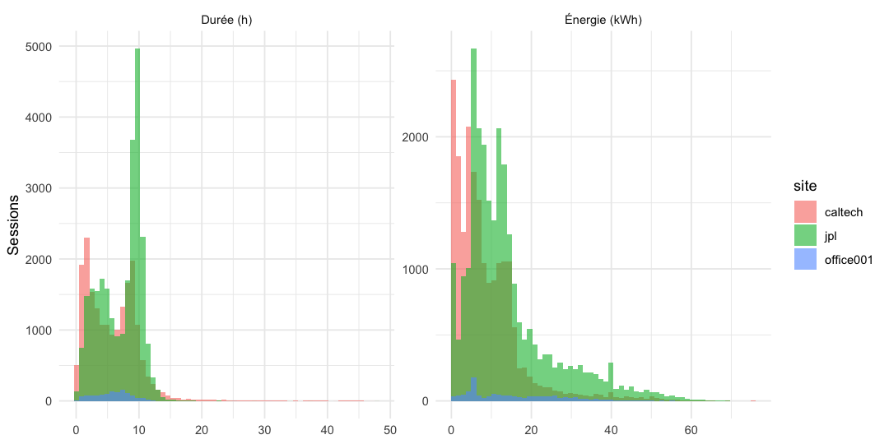
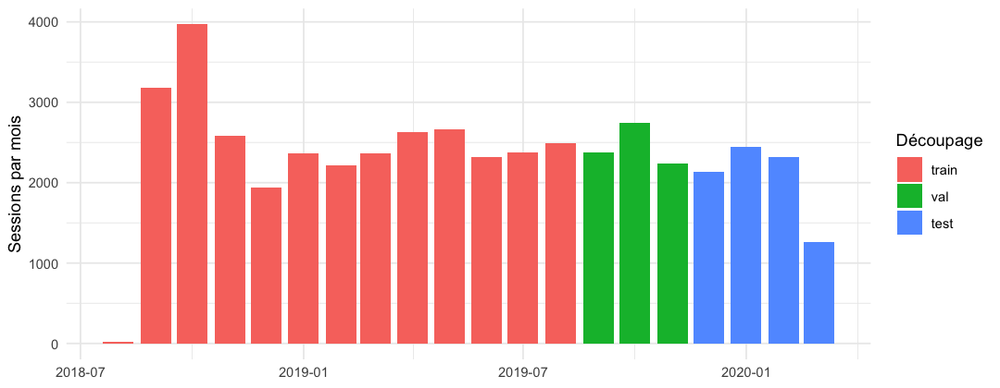
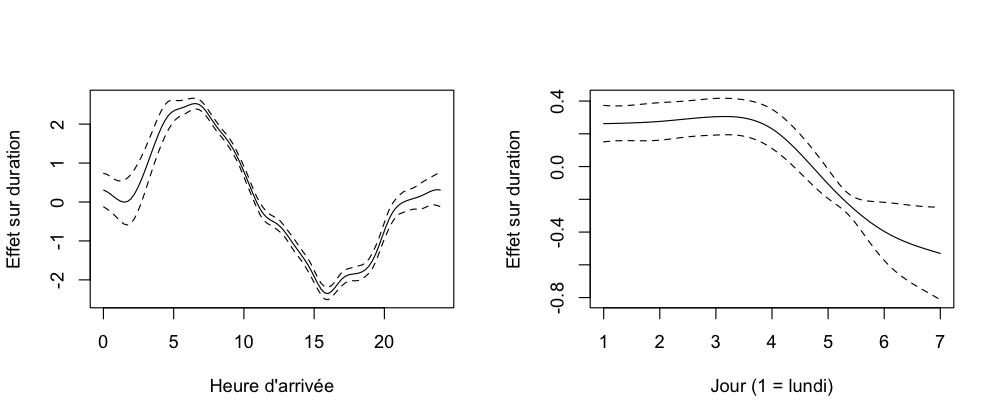
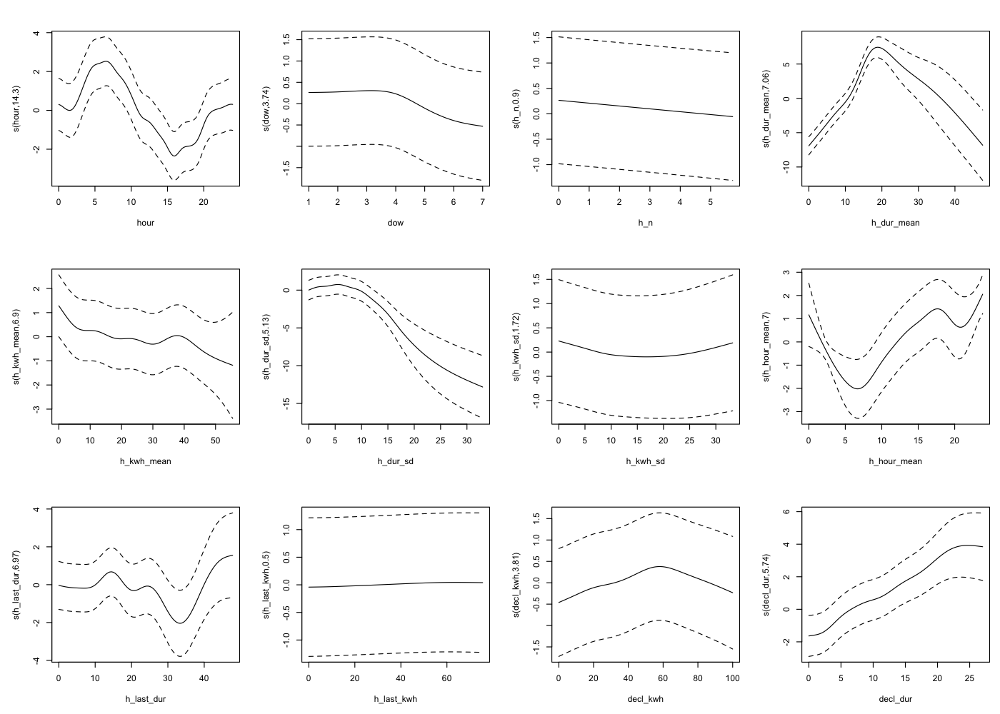
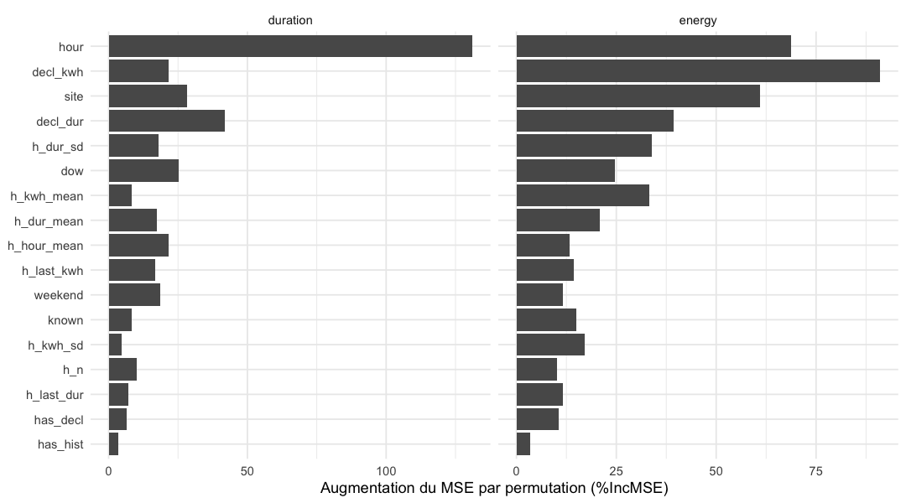

```{r setup, include = FALSE}
knitr::opts_knit$set(root.dir = normalizePath(".."))
knitr::opts_chunk$set(echo = TRUE, message = FALSE, warning = FALSE, fig.align = "center")
```

Ce notebook rassemble les résultats du projet. Les modèles sont entraînés par les scripts de `src/`
(un script par famille, voir la section *Reproduire*) ; le notebook relit les métriques
(`reports/results/*.csv`) et les figures qu'ils produisent, afin que le rendu reste rapide.
Le texte détaillé (motivation de chaque modèle, interprétation, limites) est dans `reports/rapport.md`.

## 1. Données et variables

```{r donnees}
source("src/features.R")
s <- load_sessions()
table(s$split)
str(s[, c("duration", "energy", ALL_VARS)])
```

- Cibles : durée de stationnement `duration` (h, déconnexion moins connexion) et énergie livrée `energy` (kWh).
- Variables connues à l'arrivée : site, heure locale (America/Los_Angeles), jour, week-end, usager identifié ou non,
  historique de l'usager (sessions **terminées avant** l'arrivée uniquement), énergie et durée déclarées dans l'application.
- Découpage temporel : train sept. 2018 à août 2019, validation sept. à nov. 2019, test déc. 2019 à mars 2020.
  Les hyperparamètres sont réglés par validation croisée sur le train ; la validation sert à l'early stopping du MLP.

```{r eda-tab}
knitr::kable(read.csv("reports/results/eda_resume.csv"), digits = 2)
```






## 2. Baselines

```{r baselines}
knitr::kable(read.csv("reports/results/baselines.csv"), digits = 3)
```

## 3. Régression linéaire, ridge, lasso

```{r lin}
knitr::kable(read.csv("reports/results/lineaires.csv"), digits = 4)
cf <- read.csv("reports/results/lineaires_coefs.csv")
knitr::kable(subset(cf, model == "Lasso")[, -1], digits = 3)
```


## 4. PCA de l'historique et régression sur composantes

```{r pca}
knitr::kable(read.csv("reports/results/pca_variance.csv"), digits = 3)
knitr::kable(read.csv("reports/results/pca_loadings.csv"), digits = 3)
knitr::kable(read.csv("reports/results/pca.csv"), digits = 3)
```


## 5. GAM

```{r gam}
knitr::kable(read.csv("reports/results/gam.csv"), digits = 3)
knitr::kable(read.csv("reports/results/gam_edf.csv"), digits = 3)
```





## 6. Arbre, bagging, random forest

```{r arbres}
knitr::kable(read.csv("reports/results/arbres.csv"), digits = 3)
knitr::kable(read.csv("reports/results/rf_oob.csv"), digits = 3)
```




## 7. SVR à noyau RBF

```{r svr}
knitr::kable(read.csv("reports/results/svr.csv"), digits = 3)
g <- read.csv("reports/results/svr_grille.csv")
knitr::kable(g[, c("target", "cost", "gamma", "error")], digits = 2)
```

## 8. MLP (torch)

```{r mlp}
knitr::kable(read.csv("reports/results/mlp_grille.csv"), digits = 4)
knitr::kable(read.csv("reports/results/mlp.csv"), digits = 3)
```


## 9. Comparaison sur le test

```{r comp}
knitr::kable(read.csv("reports/results/comparatif.csv"), digits = 3)
```


## 10. Investigation : déclarations contre historique, selon la taille d'historique

Question : les déclarations faites dans l'application (énergie voulue, durée disponible) apportent-elles
quelque chose quand on connaît déjà l'historique de l'usager, et cela dépend-il du nombre de sessions passées ?
Même GAM ré-ajusté avec quatre jeux de variables, MAE sur le test par tranche d'historique.

```{r invest}
r <- read.csv("reports/results/investigation.csv")
w <- reshape(r[, c("target", "variables", "historique", "MAE")], idvar = c("target", "historique"),
             timevar = "variables", direction = "wide")
names(w) <- sub("MAE.", "", names(w))
knitr::kable(w, digits = 2, row.names = FALSE)
```


## 11. Export pour le simulateur IA04

```{r export}
source("src/predict.R")
m <- load_model()
m$features
predict_session("jpl", as.POSIXct("2020-01-15 08:30", tz = TZ_LOCAL), user_id = s$userID[which(s$has_hist == 1)[1]],
                kwh_requested = 20, minutes_available = 540, past = s)
head(read.csv("reports/predictions.csv"))
```

## Reproduire

```
Rscript src/eda.R
Rscript src/models_baseline.R
Rscript src/models_linear.R
Rscript src/models_pca.R
Rscript src/models_gam.R
Rscript src/models_trees.R     # ~40 min (random forest)
Rscript src/models_svr.R       # ~3 min
Rscript src/models_mlp.R       # torch
Rscript src/compare.R
Rscript src/investigation.R
Rscript src/export.R
Rscript -e 'rmarkdown::render("reports/projet.Rmd")'
```
