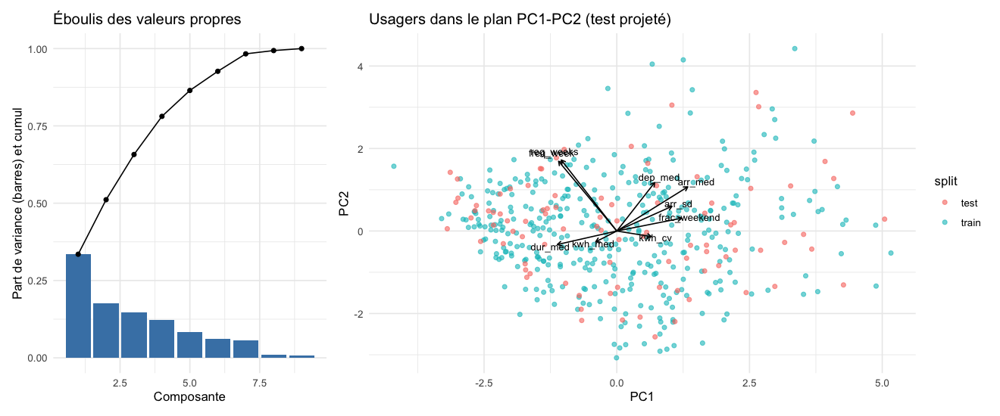
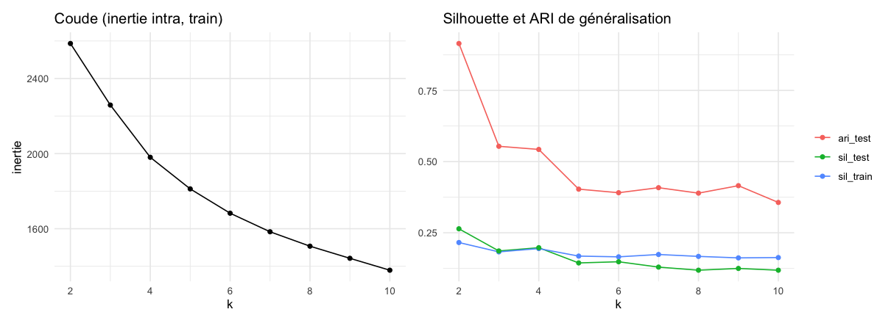
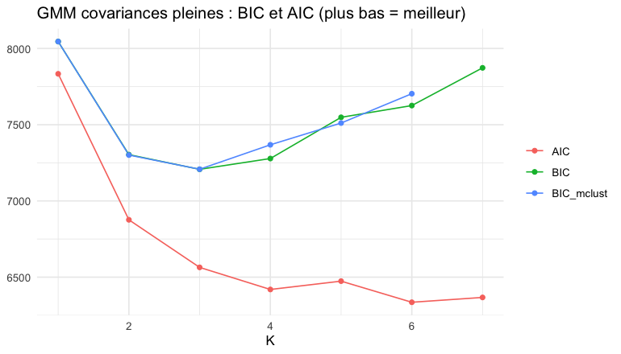
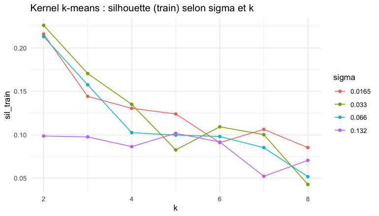
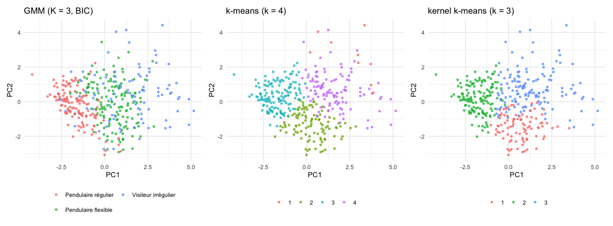
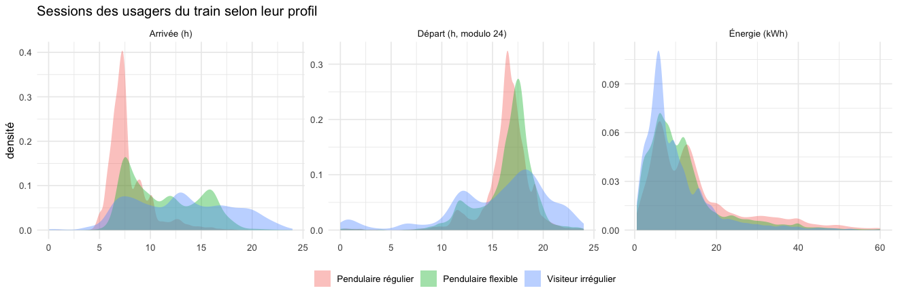
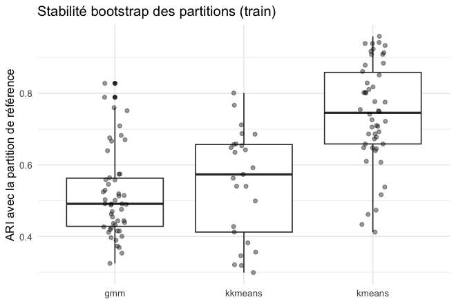
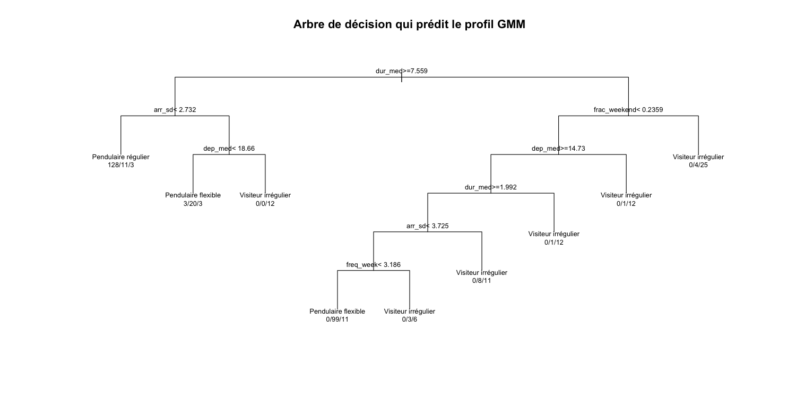
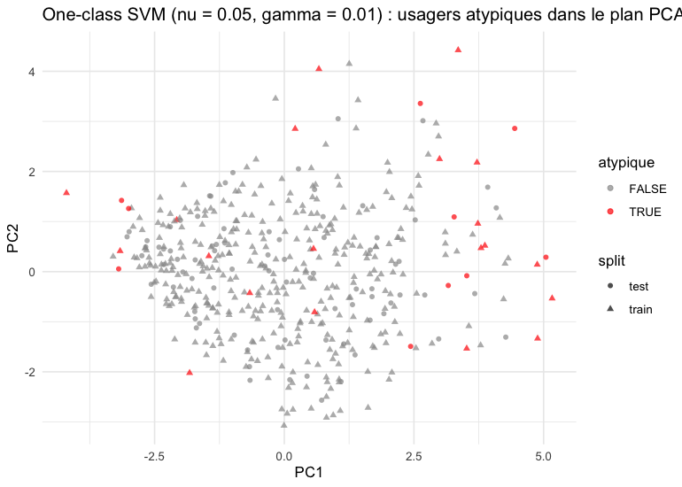
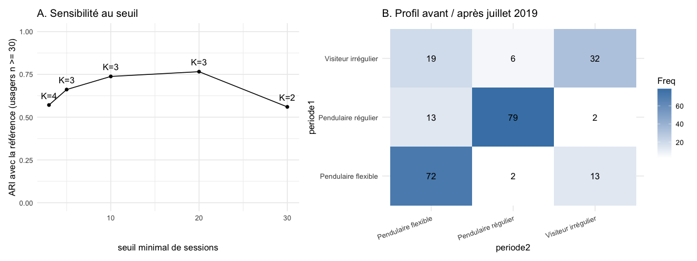

```{r setup, include = FALSE}
knitr::opts_knit$set(root.dir = normalizePath(".."))   # exécution depuis la racine du dépôt
knitr::opts_chunk$set(message = FALSE, warning = FALSE, fig.align = "center")
```

```{r libs}
suppressPackageStartupMessages({ library(knitr); library(dplyr); library(mclust); library(cluster) })
source("src/features.R"); source("src/em_gmm.R")
res <- function(f) read.csv(file.path("reports/results", f), check.names = FALSE)
set.seed(19)
```

Objectif : découvrir, sans étiquettes, des profils d'usagers des bornes ACN (Caltech, JPL, office001,
septembre 2018 à mars 2020), puis en faire les types d'agents du simulateur multi-agents de l'UV IA04.

Les scripts de `src/` produisent tous les résultats. Les étapes courtes sont recalculées ici, en direct. Les
étapes longues (bootstrap, grilles, générateur) sont relues depuis `reports/results/`. Le rapport détaillé se
trouve dans `reports/rapport.md`.

# Données et variables par usager

```{r donnees}
s <- clean_sessions(load_acn())
cat(nrow(s), "sessions identifiées et nettoyées,", length(unique(s$userID)), "usagers\n")
kable(res("seuils_sessions.csv"), caption = "Seuil minimal de sessions : usagers gardés et erreur relative sur un écart-type")
L <- load_users()
cat("Usagers retenus (au moins", MIN_SESSIONS, "sessions) :", nrow(L$u), "| train :", nrow(L$tr), "| test :", nrow(L$te), "\n")
kable(head(L$tr[, c("n", "site", CLUST_VARS)]), digits = 2, caption = "Neuf variables par usager (extrait)")
```

Choix du seuil : 10 sessions. On garde ainsi 97 % des sessions identifiées et l'écart-type des heures
d'arrivée est estimé à environ 24 % près. 20 % des usagers sont mis de côté pour le test. La standardisation
et tous les modèles sont appris sur le train seulement. Les variables asymétriques passent au log et les
proportions, lissées, au logit.

# Standardisation et PCA

```{r pca}
p <- prcomp(L$ztr)
kable(t(round(summary(p)$importance[2:3, 1:5], 3)), caption = "Part de variance expliquée")
kable(round(p$rotation[, 1:2], 2), caption = "Coordonnées des variables sur PC1 et PC2")
```



PC1 oppose les usagers tardifs, irréguliers et présents le week-end aux usagers qui restent longtemps et
viennent souvent. PC2 porte surtout la fréquence et la régularité. Le nuage est continu, sans amas nets.

# Baseline k-means

```{r kmeans}
kable(res("kmeans_choix_k.csv"), digits = 3, caption = "Choix de k : inertie, silhouettes, ARI de généralisation")
```



k = 2 oppose seulement les arrivées du matin et de l'après-midi. Parmi k ≥ 3, k = 4 a la meilleure
silhouette. On obtient des pendulaires réguliers, des pendulaires occasionnels, des usagers de l'après-midi et
un petit groupe nocturne.

# GMM estimé par EM codé à la main

Le code complet de l'EM (E-step en log-sum-exp, densité calculée par Cholesky, covariances pleines, plusieurs
initialisations, BIC et AIC) :

```{r em_code, echo = FALSE, comment = ""}
cat(readLines("src/em_gmm.R"), sep = "\n")
```

On recalcule ici, en direct, le modèle à K = 3, et on le compare à mclust :

```{r em_live}
fit3 <- em_gmm(L$ztr, 3, n_init = 50)
mc3 <- Mclust(L$ztr, G = 3, modelNames = "VVV", verbose = FALSE)
c(logL_maison = fit3$loglik, logL_mclust = mc3$loglik, BIC_maison = fit3$bic,
  ARI_maison_mclust = adjustedRandIndex(fit3$cluster, mc3$classification))
kable(res("gmm_choix_K.csv"), digits = 2, caption = "Choix de K (BIC et AIC, plus bas = meilleur ; logL de test par usager)")
```



Le BIC choisit K = 3. La vraisemblance des usagers de test, jamais vus à l'apprentissage, est aussi maximale
à K = 3. L'AIC (K = 6) surajuste : il faut 55 paramètres par composante pour seulement 373 usagers.

# Kernel k-means

```{r kkmeans}
g <- res("kkmeans_grille.csv")
kable(g[g$k <= 5, ], digits = 3, caption = "Grille sigma x k (extrait, k ≤ 5)")
```



On retient le noyau RBF avec sigma = 0,033 et k = 3 (meilleure silhouette parmi k ≥ 3).

# Profils et noms

```{r profils}
kable(res("profils_gmm.csv"), digits = 2, caption = "Médianes par profil GMM, train et test")
```





- **Pendulaire régulier** (35 %) : arrive vers 7 h 20 et repart vers 16 h 45, reste branché 9 h, vient
  2 fois par semaine.
- **Pendulaire flexible** (39 %) : arrive vers 8 h ou vers 15 h-16 h, reste 5 h, vient 1 fois par semaine.
- **Visiteur irrégulier** (25 %) : horaires très dispersés, plus de week-end, surtout sur le campus de Caltech.

# Validation : stabilité, LDA et arbre

```{r validation}
kable(res("stabilite_bootstrap.csv"), digits = 3, caption = "ARI bootstrap avec la partition de référence")
kable(res("explication_profils.csv"), digits = 3, caption = "Prédiction du profil GMM à partir des variables brutes")
```





# One-class SVM : usagers atypiques

```{r ocsvm}
kable(res("ocsvm_grille.csv"), digits = 3, caption = "nu et gamma : taux d'atypiques en CV, sur le train et sur le test")
kable(res("ocsvm_atypiques.csv"), digits = 2, caption = "Médianes : usagers typiques et atypiques (nu = 0,05, gamma = 0,01)")
```



# Investigation originale : robustesse des profils

**A. Sensibilité au seuil minimal de sessions.** **B. Stabilité d'un même usager entre deux périodes**
(avant et après juillet 2019).

```{r investigation}
kable(res("investigation_seuil.csv"), digits = 3, caption = "A. K choisi par BIC et ARI avec la référence (usagers à 30 sessions ou plus)")
kable(res("investigation_periodes.csv"), digits = 3, caption = "B. Même profil sur les deux périodes")
kable(res("investigation_correlations.csv"), digits = 2, caption = "B. Corrélation des variables d'un usager entre les deux périodes")
```



K = 3 est stable pour un seuil de 5 à 20 sessions. 77 % des usagers gardent leur profil d'une période à
l'autre, contre 35 % attendus au hasard (kappa 0,64). Les horaires sont des traits stables ; la régularité
hebdomadaire est la variable la plus fragile.

# Générateur d'agents pour IA04

```{r generateur}
source("src/generate_agents.R")
P <- read_agents_params()
kable(data.frame(profil = sapply(P$profiles, `[[`, "name"),
                 part_usagers = sapply(P$profiles, `[[`, "weight"),
                 part_sessions = sapply(P$profiles, `[[`, "session_share"),
                 composantes = sapply(P$profiles, function(p) length(p$components))),
      caption = "Paramètres exportés dans reports/results/agents_gmm.json")
v <- generate_agents(5, P, seed = 1)
kable(v, digits = 2, caption = "Cinq véhicules générés")
kable(res("ks_generateur.csv"), caption = "Statistique D de Kolmogorov-Smirnov, sessions générées contre sessions réelles")
```

Sur le train, D reste inférieur à 0,06. Sur les usagers de test, l'écart est du même ordre que celui qui
sépare déjà les sessions réelles du train et du test.

# Comparaison et conclusion

```{r comparaison}
kable(res("comparaison.csv"), caption = "Comparaison des méthodes")
```

La baseline k-means a la meilleure silhouette et la meilleure stabilité bootstrap. La silhouette favorise
toutefois les partitions sphériques que le k-means optimise. **Pour IA04, on retient le GMM K = 3** : c'est le
seul modèle génératif des trois, K est choisi par BIC et confirmé par la vraisemblance de test, les profils
se prédisent à 83 % sur le test avec un arbre, ils sont stables dans le temps (kappa 0,64), et le générateur
est validé par Kolmogorov-Smirnov.

Limites : la structure des usagers est faible (silhouette inférieure à 0,27), le GMM a beaucoup de paramètres
pour 373 usagers, le générateur ignore la corrélation entre les sessions d'un même usager, et l'énergie
modélisée est l'énergie livrée, pas l'énergie demandée. Le détail et le lien avec les stratégies EDF, LLF et
sLLF sont dans `reports/rapport.md`.
