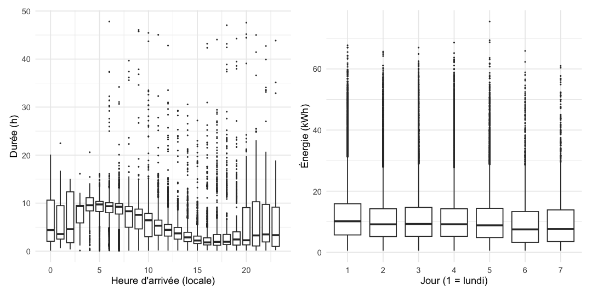
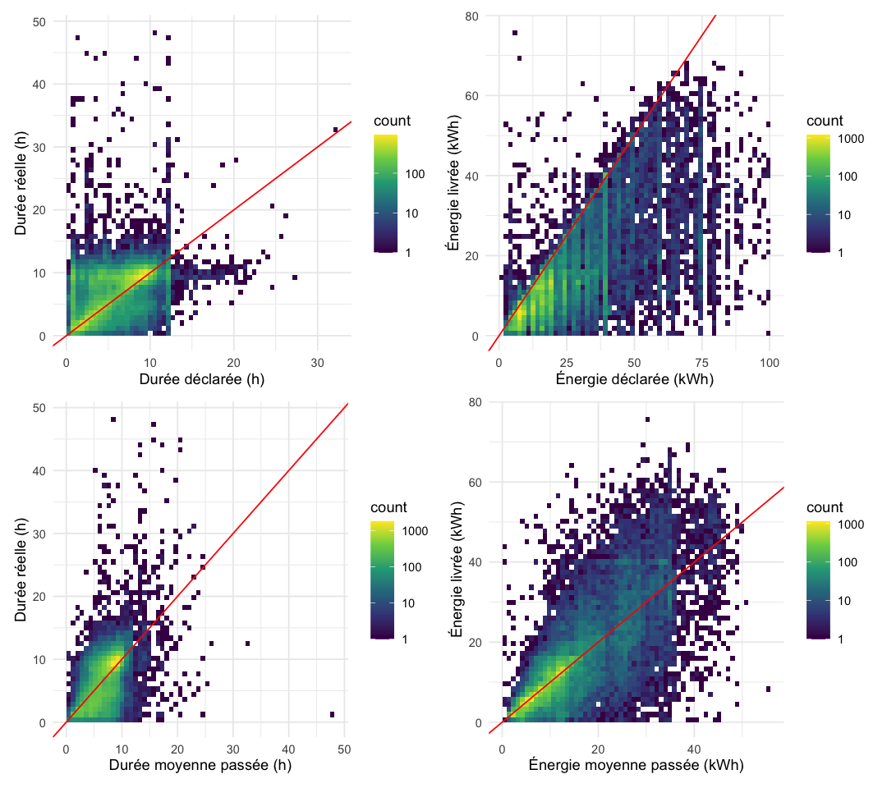
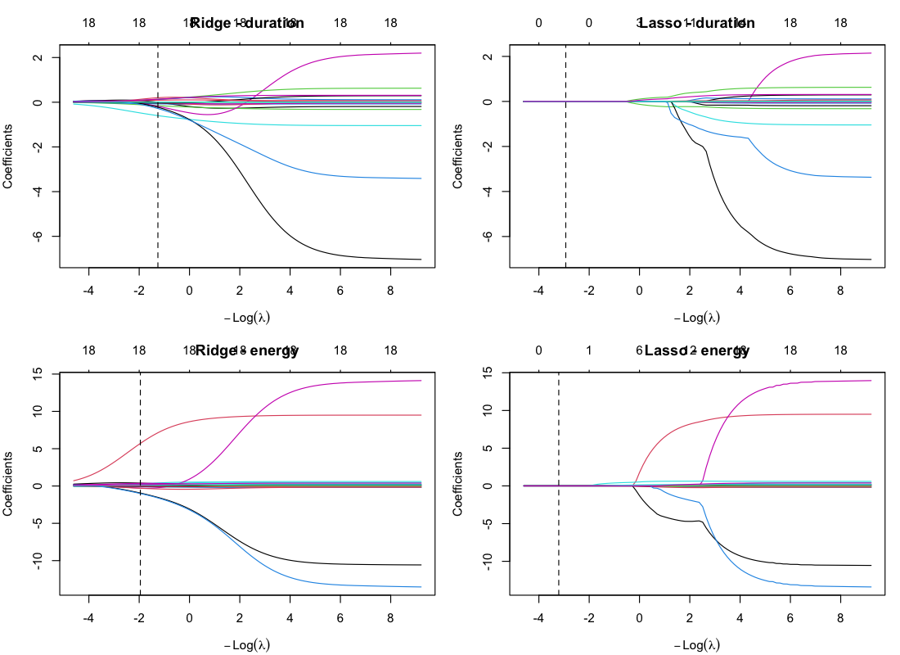
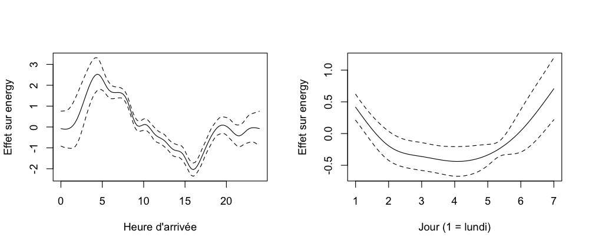
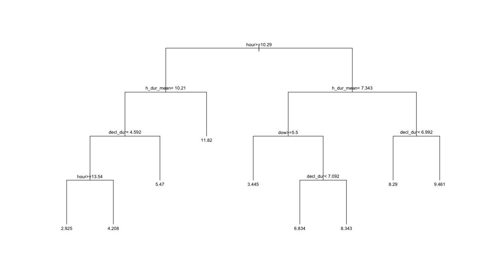
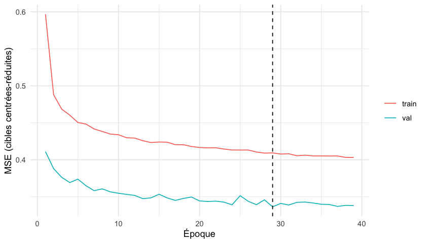
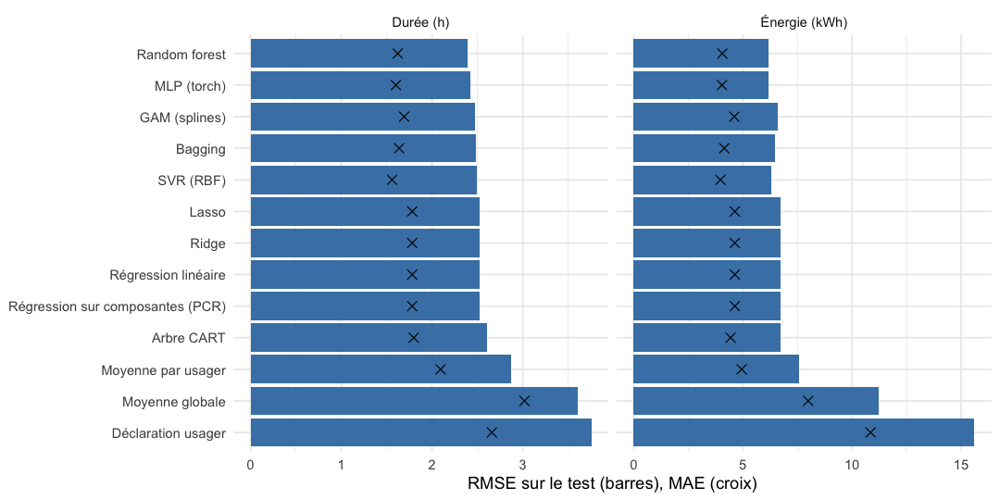

# SY19, projet 1 : prédire à l'arrivée la durée de stationnement et l'énergie d'une session de recharge

Données ACN-Data (Caltech), sites caltech, jpl et office001, septembre 2018 à mars 2020. Tout le code est en R
(`src/`), chaque chiffre ci-dessous provient d'un fichier de `reports/results/` écrit par le script indiqué.
Notebook rendu : `reports/projet.html` (source `reports/projet.Rmd`).

## 1. Problème, données et protocole

**Question.** Quand un véhicule se branche, on veut prédire (a) combien de temps il restera branché
(`duration`, heures, déconnexion moins connexion) et (b) combien d'énergie il prendra (`energy`, kWh livrés).
Ce sont exactement les deux paramètres dont un ordonnanceur de recharge a besoin (échéance et demande).

**Nettoyage** (`src/features.R`). Sur 46 701 sessions, on garde les 46 646 dont la durée est comprise
entre 5 min et 48 h. Les heures sont converties en heure locale (America/Los_Angeles) avant d'en extraire l'heure
et le jour. Les déclarations aberrantes (énergie hors de ]0, 100] kWh, durée hors de ]0, 48] h) sont mises à NA.

**Variables connues à l'arrivée.**
- contexte : `site`, `hour` (heure décimale locale), `dow` (1 = lundi), `weekend`, `known` (usager identifié) ;
- déclarations de l'application : `has_decl`, `decl_kwh` (kWhRequested), `decl_dur` (minutesAvailable / 60) ;
- historique de l'usager : `h_n` (log(1 + nombre de sessions passées)), moyenne et écart-type passés de la durée et
  de l'énergie, heure d'arrivée moyenne, durée et énergie de la dernière session, `has_hist`.

**Pas de fuite.** L'historique d'une session arrivant à l'instant t n'utilise que les sessions du même usager
**déjà terminées** à t (`disconnectTime < t`), et pas seulement « commencées avant » : une session encore en cours
n'a pas de durée connue. Le calcul est vectorisé (`findInterval` sur les fins triées, sommes cumulées) et testé
sur un cas construit à la main (`tests/test_features.R`). Sans historique ou sans déclaration, la variable vaut 0
et l'indicateur (`has_hist`, `has_decl`) vaut 0, ce qui donne à chaque groupe sa propre constante.

**Découpage temporel** (pas de mélange aléatoire, pour imiter l'usage réel) :

| Partie | Période | Sessions |
|---|---|---|
| train | sept. 2018 à août 2019 | 31 121 |
| validation | sept. à nov. 2019 | 7 360 |
| test | déc. 2019 à mars 2020 | 8 165 |

Les hyperparamètres sont réglés par validation croisée **sur le train uniquement** (10 plis pour glmnet, PCR et
l'arbre, OOB pour la random forest, 5 plis pour la SVR, 3 plis pour le MLP). La validation sert à l'early stopping
du MLP et au contrôle ; le test n'est lu qu'à la fin. Les plis de CV sont aléatoires à l'intérieur du train, ce qui
est un peu optimiste pour des données temporelles (voir Limites). Métriques : MAE, RMSE, R² sur le test.

## 2. Analyse exploratoire (`src/eda.R`)

- Durée moyenne 5,6 à 7,2 h selon le site et la période ; distribution bimodale à jpl (passages courts et
  journée de travail complète). Énergie très asymétrique (médiane 5 à 14 kWh, queue jusqu'à 75 kWh).
- L'heure d'arrivée est la variable de contexte la plus forte : corrélation -0,45 avec la durée sur le train
  (arriver à 7 h, c'est rester la journée ; arriver à 16 h, c'est repartir le soir).
- L'historique est très informatif : corrélation 0,44 entre durée et durée moyenne passée, 0,72 entre énergie et
  énergie moyenne passée. L'énergie déclarée est corrélée à 0,66 avec l'énergie livrée, mais elle surestime
  nettement (nuage sous la diagonale, valeurs rondes 10, 20, 25, 40... kWh). La durée déclarée plafonne vers 12,5 h
  (limite de l'application) et est corrélée à 0,44 avec la durée réelle.
- office001 n'a quasiment pas d'usagers identifiés avant le test (`eda_resume.csv`) ; la part d'usagers identifiés
  passe de 62 % (train) à 82 % (test) à caltech, d'où un léger glissement de distribution entre train et test.

## 3. Baselines (`src/models_baseline.R`)

| Modèle (test) | Durée MAE | Durée RMSE | Durée R² | Énergie MAE | Énergie RMSE | Énergie R² |
|---|---|---|---|---|---|---|
| Moyenne globale du train | 3,02 | 3,61 | 0,00 | 7,99 | 11,21 | -0,01 |
| Moyenne passée de l'usager (sinon globale) | 2,10 | 2,88 | 0,36 | 4,94 | 7,59 | 0,54 |
| Déclaration brute (sinon moyenne usager) | 2,66 | 3,75 | -0,08 | 10,85 | 15,61 | -0,96 |

**Pourquoi.** Elles fixent le niveau à battre : un modèle qui ne fait pas mieux que « la moyenne de l'usager »
n'apporte rien au simulateur. **Interprétation.** La moyenne par usager est déjà une baseline forte (R² 0,54 en
énergie). Prendre la déclaration au pied de la lettre est **pire que la moyenne globale** : les usagers surestiment
leur besoin d'énergie et déclarent des durées arrondies. Les déclarations doivent donc être recalibrées par un
modèle, pas utilisées brutes.

## 4. Régression linéaire, ridge, lasso (`src/models_linear.R`)

**Pourquoi.** Modèle de référence interprétable ; ridge et lasso testent si la régularisation ou la sélection de
variables aide, avec λ choisi par CV 10 plis sur une grille de 10² à 10⁻⁴.

| Test | Durée MAE | RMSE | R² | Énergie MAE | RMSE | R² |
|---|---|---|---|---|---|---|
| Linéaire (MCO) | 1,782 | 2,527 | 0,509 | 4,630 | 6,713 | 0,638 |
| Ridge (λ min) | 1,782 | 2,527 | 0,509 | 4,630 | 6,713 | 0,638 |
| Lasso (λ min) | 1,782 | 2,527 | 0,509 | 4,630 | 6,713 | 0,638 |

**Interprétation.** Le λ optimal de la CV est la plus petite valeur de la grille (10⁻⁴) : avec 31 000 sessions pour
18 variables, la variance d'estimation est négligeable et la régularisation n'améliore rien ; les trois modèles
coïncident. Le chemin du lasso reste utile pour lire l'ordre d'entrée des variables. Au λ « 1-SE » (plus parcimonieux),
le lasso écarte pour la durée `siteoffice001`, `known`, `h_kwh_mean`, `h_last_kwh` et `decl_kwh` (l'énergie ne dit
rien sur la durée une fois l'historique de durée connu), et garde toutes les variables pour l'énergie sauf
`sitejpl`. Coefficients (MCO, durée) : +0,63 h par heure de durée moyenne passée, +0,31 h par heure déclarée,
-0,32 h par heure d'arrivée plus tardive, -1,0 h le week-end (`lineaires_coefs.csv`). Gain sur la baseline usager :
MAE durée 2,10 → 1,78, énergie 4,94 → 4,63.

## 5. PCA de l'historique et régression sur composantes (`src/models_pca.R`)

**Pourquoi.** Les 8 variables d'historique sont très corrélées (moyenne et dernière valeur, moyenne et écart-type).
La PCA (centrée-réduite, ajustée sur les sessions du train ayant un historique) les résume ; la PCR remplace ces
8 variables par k composantes, k choisi par CV 10 plis.

- Variance expliquée : 35 % (PC1), 24 % (PC2), 15 % (PC3) ; 4 composantes font 86 %.
- PC1 = « gros rouleur » (poids forts sur l'énergie moyenne, son écart-type et la dernière énergie) ;
  PC2 oppose la durée passée (négatif) à l'heure d'arrivée habituelle (positif) : « arrive tôt et reste longtemps »
  contre « arrive tard, reste peu » ; PC3 = variabilité de la durée.
- La RMSE de CV décroît continûment avec k (durée 3,24 sans historique, 3,06 à k = 4, 2,99 à k = 8) :
  la CV retient k = 8, c'est-à-dire la régression linéaire complète (mêmes résultats test : 1,782 / 4,630 de MAE).

**Interprétation.** La réduction de dimension n'apporte pas de gain prédictif ici (pas de problème de dimension avec
n = 31 000), mais elle donne une lecture claire des profils d'usagers. Les dernières composantes, de faible variance,
portent encore de l'information utile pour la cible : c'est la limite classique de la PCR, qui choisit les directions
sans regarder y.

## 6. GAM (`src/models_gam.R`)

**Pourquoi.** L'effet de l'heure d'arrivée n'a aucune raison d'être linéaire ni monotone, et il est cyclique (23 h 59
est proche de 0 h). Le GAM (mgcv, `bam`) utilise une spline cyclique sur l'heure (k = 20), une spline sur le jour et
des splines sur chaque variable d'historique et de déclaration. Les lissages sont choisis par REML et
`select = TRUE` ajoute une pénalité qui peut annuler entièrement un terme (sélection de variables intégrée).

| Test | Durée MAE | RMSE | R² | Énergie MAE | RMSE | R² |
|---|---|---|---|---|---|---|
| GAM | 1,693 | 2,472 | 0,530 | 4,606 | 6,614 | 0,649 |

**Interprétation.** L'effet partiel de l'heure sur la durée est fortement non linéaire (14 degrés de liberté
effectifs) : maximum pour les arrivées vers 6-7 h (+2,5 h), minimum vers 16 h (-2,5 h), remontée le soir
(sessions de nuit). Le jour a un effet faible, décroissant vers le week-end. La pénalité de sélection annule presque
`h_last_kwh` pour la durée (edf 0,5, p = 0,22) et `h_dur_sd` pour l'énergie (edf 0,001) : mêmes conclusions que le
lasso. Gain modeste mais net sur le linéaire en durée (MAE 1,78 → 1,69), plus faible en énergie.

## 7. Arbre, bagging, random forest (`src/models_trees.R`)

**Pourquoi.** Les arbres captent sans spécification les interactions et seuils (par exemple « arrivée avant 9 h à
jpl avec un long historique »). L'arbre seul est instable ; le bagging réduit sa variance en moyennant 50 arbres
profonds sur des échantillons bootstrap ; la random forest décorrèle en plus les arbres en tirant `mtry` variables
candidates à chaque coupure.

**Protocole.** Arbre CART : arbre profond (cp = 10⁻⁴) puis élagage par la règle 1-SE sur l'erreur de CV 10 plis
interne à rpart (train). Bagging : 50 arbres non élagués (ipred). Random forest : 300 arbres, mtry ∈ {3, 5, 8, 12}
choisi par l'erreur out-of-bag du train (`rf_oob.csv`) : mtry = 5 pour la durée (RMSE OOB 2,757), 8 pour l'énergie
(5,228). Environ 25 min de calcul au total (importance par permutation comprise).

| Test | Durée MAE | RMSE | R² | Énergie MAE | RMSE | R² |
|---|---|---|---|---|---|---|
| Arbre CART (17 / 49 feuilles) | 1,799 | 2,602 | 0,479 | 4,436 | 6,710 | 0,639 |
| Bagging (50 arbres) | 1,639 | 2,484 | 0,525 | 4,145 | 6,467 | 0,664 |
| Random forest | 1,622 | **2,396** | **0,559** | 4,060 | 6,179 | 0,694 |

**Interprétation.** L'arbre élagué (17 feuilles pour la durée) fait à peine moins bien que la régression linéaire
tout en étant lisible : la première coupure sépare les arrivées avant et après 10 h 17, puis viennent la durée moyenne passée et la durée déclarée (figure limitée aux 8 premières coupures).
Le bagging gagne 0,12 h de RMSE sur l'arbre seul (réduction de variance) et la random forest encore 0,09 h : c'est le
meilleur modèle en RMSE et en R² pour la durée. L'importance par permutation (%IncMSE) place l'heure d'arrivée
largement en tête pour la durée (131), devant la durée déclarée (42) et le site (28) ; pour l'énergie, l'énergie
déclarée (91) passe devant l'heure (69) et le site (61). Les déclarations sont donc utilisées par la forêt, alors
que, brutes, elles sont de mauvaises prédictions (section 3) : le modèle les recalibre.

## 8. SVR à noyau RBF (`src/models_svr.R`)

**Pourquoi.** Méthode à noyau du cours, non linéaire, perte ε-insensible (robuste aux grosses erreurs, ce qui
favorise la MAE). **Coût.** L'ajustement est super-linéaire en n : la grille (C ∈ {0,3 ; 1 ; 3 ; 10},
γ ∈ {0,01 ; 0,03 ; 0,1 ; 0,3}) est évaluée par CV 5 plis sur 4 000 sessions du train, puis le modèle final est
ajusté sur 10 000 sessions tirées au hasard dans le train (environ 1 min par cible). Variables centrées-réduites.

| Test | Durée MAE | RMSE | R² | Énergie MAE | RMSE | R² |
|---|---|---|---|---|---|---|
| SVR (C = 3, γ = 0,03) | 1,560 | 2,495 | 0,521 | 3,972 | 6,281 | 0,683 |

**Interprétation.** La SVR a la meilleure MAE de tous les modèles alors qu'elle n'a vu qu'un tiers du train, mais
une RMSE moins bonne que le GAM en durée : la perte ε-insensible vise la médiane conditionnelle et se trompe davantage
sur les sessions extrêmes (très longues ou très gourmandes). Environ 7 000 vecteurs supports sur 10 000 : le bruit
est élevé par rapport au signal, peu de points sont dans le tube ε.

## 9. MLP (`src/models_mlp.R`, torch pour R)

**Pourquoi.** Réseau de neurones du cours, capable de modéliser les interactions (heure × site × historique).
Un seul réseau prédit les deux cibles (deux sorties, cibles centrées-réduites, perte MSE). Architecture : 2 couches
cachées ReLU de largeur w avec dropout d, Adam (lr 10⁻³, weight decay 10⁻⁵), mini-lots de 512.
`torch` s'est installé sans problème (CPU, arm64).

**Protocole.** (w, d) ∈ {32, 128} × {0 ; 0,2} choisis par CV 3 plis sur le train, chaque pli avec early stopping
(patience 10 époques) sur son pli de validation. Meilleur : w = 128, d = 0,2 (MSE de CV 0,403 contre 0,405 à 0,417).
Le modèle final est entraîné sur le train avec early stopping sur la période de validation : arrêt à l'époque 39,
poids de l'époque 29 conservés.

| Test | Durée MAE | RMSE | R² | Énergie MAE | RMSE | R² |
|---|---|---|---|---|---|---|
| MLP 2×128 | 1,602 | 2,420 | 0,549 | 4,041 | 6,157 | 0,696 |

**Interprétation.** Le MLP est le meilleur modèle en énergie (RMSE 6,157, R² 0,696) et le deuxième en
durée, à 0,024 h de la random forest. L'early stopping est indispensable : la perte de validation remonte après une
trentaine d'époques alors que celle d'entraînement continue de baisser. Le dropout de 0,2 apporte un léger gain en CV.
Avantage pratique décisif pour la suite : le réseau n'est qu'une suite de produits matrice-vecteur, donc trivial à
exporter et à réimplémenter en Go (section 12), contrairement à une forêt de 300 arbres.

## 10. Comparaison sur le test (`src/compare.R`)

Classement par RMSE de test (`reports/results/comparatif.csv`) :

| Modèle | Durée MAE (h) | Durée RMSE | Durée R² | Énergie MAE (kWh) | Énergie RMSE | Énergie R² |
|---|---|---|---|---|---|---|
| Moyenne globale | 3,02 | 3,61 | 0,00 | 7,99 | 11,21 | -0,01 |
| Déclaration brute | 2,66 | 3,75 | -0,08 | 10,85 | 15,61 | -0,96 |
| Moyenne par usager | 2,09 | 2,88 | 0,36 | 4,94 | 7,59 | 0,54 |
| Linéaire / ridge / lasso / PCR | 1,78 | 2,53 | 0,51 | 4,63 | 6,71 | 0,64 |
| Arbre CART | 1,80 | 2,60 | 0,48 | 4,44 | 6,71 | 0,64 |
| GAM | 1,69 | 2,47 | 0,53 | 4,61 | 6,61 | 0,65 |
| Bagging | 1,64 | 2,48 | 0,53 | 4,14 | 6,47 | 0,66 |
| SVR RBF | **1,56** | 2,50 | 0,52 | **3,97** | 6,28 | 0,68 |
| Random forest | 1,62 | **2,40** | **0,56** | 4,06 | 6,18 | 0,69 |
| MLP (torch) | 1,60 | 2,42 | 0,55 | 4,04 | **6,16** | **0,70** |

**Lecture.**
- Tous les modèles appris battent nettement les baselines : par rapport à la moyenne par usager, la meilleure RMSE
  baisse de 17 % en durée (2,88 → 2,40) et de 19 % en énergie (7,59 → 6,16).
- Les modèles non linéaires (forêt, MLP, SVR) gagnent environ 0,1 h de RMSE et 0,5 kWh sur les modèles linéaires :
  il y a des interactions et des seuils, mais le gros du signal est déjà capté par l'historique et l'heure.
- Forêt et MLP sont à égalité pratique (écarts de 1 %) ; la SVR a la meilleure MAE car sa perte ε-insensible vise
  l'erreur absolue, au prix d'une RMSE plus forte.
- **Modèle retenu : le MLP** (meilleure RMSE énergie, deuxième en durée à 1 % de la forêt), parce qu'il est
  exportable tel quel vers le simulateur Go. Ses performances de test : durée MAE 1,60 h, RMSE 2,42 h, R² 0,55 ;
  énergie MAE 4,04 kWh, RMSE 6,16 kWh, R² 0,70.

## 11. Investigation : les déclarations de l'usager servent-elles quand on connaît son historique ?

**Question.** L'application demande à l'usager l'énergie voulue et l'heure de départ. Ces déclarations sont coûteuses
(saisie) et peu fiables (section 3). Apportent-elles de l'information **en plus** de l'historique, et cela dépend-il
du nombre de sessions passées connues ?

**Expérience** (`src/investigation.R`). Le même GAM (rapide à ré-ajuster) est entraîné avec quatre jeux de
variables : contexte seul, contexte + historique, contexte + déclarations, tout. La MAE est calculée sur le test,
globalement et par tranche de nombre de sessions passées de l'usager (0 regroupe les inconnus et les premières
sessions).

MAE sur le test (durée en h, énergie en kWh) :

| Cible | Historique | n | Contexte | + historique | + déclarations | + les deux |
|---|---|---|---|---|---|---|
| durée | tous | 8 165 | 1,95 | 1,68 | 1,95 | 1,69 |
| durée | 0 | 1 056 | 2,35 | 2,35 | 2,41 | 2,36 |
| durée | 1-4 | 293 | 2,51 | 2,06 | 2,32 | 2,00 |
| durée | 5-19 | 801 | 2,18 | 1,77 | 2,11 | 1,76 |
| durée | 20-49 | 1 049 | 1,92 | 1,53 | 1,79 | 1,54 |
| durée | 50+ | 4 966 | 1,80 | 1,53 | 1,84 | 1,55 |
| énergie | tous | 8 165 | 7,62 | 4,59 | 5,42 | 4,61 |
| énergie | 0 | 1 056 | 6,88 | 7,12 | 6,77 | 6,91 |
| énergie | 1-4 | 293 | 8,40 | 6,00 | 6,05 | 5,58 |
| énergie | 5-19 | 801 | 7,84 | 5,03 | 5,71 | 4,93 |
| énergie | 20-49 | 1 049 | 9,25 | 4,96 | 6,13 | 4,82 |
| énergie | 50+ | 4 966 | 7,35 | 3,83 | 4,90 | 3,97 |

**Résultats.**
1. L'historique domine : en énergie, il fait passer la MAE de 7,62 à 4,59 kWh, contre 5,42 pour les déclarations
   seules. En durée, les déclarations seules n'améliorent pas la MAE globale (1,95 → 1,95) alors que l'historique la
   réduit de 14 % (1,68).
2. Les déclarations sont utiles **quand l'historique est court** : avec 1 à 4 sessions passées, ajouter les
   déclarations à l'historique réduit la MAE énergie de 6,00 à 5,58 kWh (-7 %) et la MAE durée de 2,06 à 2,00 h.
   Entre 5 et 49 sessions le gain est faible (2 à 3 % en énergie), et au-delà de 50 sessions il devient
   légèrement **négatif** (3,83 → 3,97 kWh) : les déclarations ajoutent du bruit que le modèle global, appris
   surtout sur des usagers moyens, ne sait pas ignorer pour les habitués.
3. Pour les sessions sans historique, rien ne remplace l'information manquante : contexte seul et modèle complet sont
   au même niveau (durée 2,35 à 2,41 h).
4. Le gain de l'historique croît avec sa taille : la MAE durée passe de 2,06 h (1-4 sessions) à 1,53 h (20 sessions et plus),
   la MAE énergie de 6,00 à 3,83 kWh (50 sessions et plus). À l'inverse, sans historique, la variable « historique »
   dégrade légèrement l'énergie (6,88 → 7,12 kWh) : le modèle confond « inconnu » et « petit consommateur ».

**Conclusion.** Pour un opérateur, demander une déclaration est surtout rentable pour les nouveaux usagers ;
pour les habitués, l'historique suffit et fait mieux. Un modèle par tranche d'historique, ou une interaction
explicite `déclaration × h_n`, est une piste d'amélioration directe.

## 12. Export pour le simulateur IA04 (`src/predict.R`, `src/export.R`)

- `src/predict.R` : `predict_session(site, arrival, user_id, kwh_requested, minutes_available, past)` construit
  les variables d'une nouvelle session (historique calculé sur les sessions de l'usager terminées avant `arrival`)
  et renvoie la durée (h) et l'énergie (kWh) prédites. L'inférence est faite en R pur à partir du JSON
  (`mlp_forward()`), c'est-à-dire exactement le calcul que doit refaire le simulateur.
- `src/export.R` écrit `reports/model_mlp.json` : noms et ordre des 18 variables d'entrée, moyennes et écarts-types
  de normalisation des entrées et des sorties, et pour chaque couche la matrice `W` (sorties × entrées), le biais `b`
  et l'activation (`relu` ou `identity`). Le script vérifie que le JSON reproduit le réseau torch à 10⁻³ près.
- `reports/predictions.csv` : 15 525 sessions de validation et de test avec durée et énergie réelles, prédites et
  déclarées, heure de connexion au format ISO 8601 avec fuseau, pour rejouer les sessions dans le simulateur.
- `tests/test_predict.R` vérifie que `predict_session()` redonne, à partir des données brutes, les prédictions
  exportées pour des sessions de test tirées au hasard (même construction de variables, pas de fuite).

Côté Go, la prédiction tient en une vingtaine de lignes : décoder le JSON dans une structure, normaliser le vecteur
d'entrée (`(x - x_mean) / x_sd`), enchaîner `h = act(W h + b)` puis dénormaliser (`y * y_sd + y_mean`).

## 13. Limites

- **Glissement temporel.** Le test (déc. 2019 à mars 2020) contient les fêtes de fin d'année et le début du COVID
  (mars 2020), et la part d'usagers identifiés augmente au fil du temps. Les performances de test sont donc un peu
  pessimistes par rapport à une période stable, mais c'est l'évaluation honnête d'un modèle déployé.
- **CV non temporelle à l'intérieur du train.** Les plis aléatoires mélangent des sessions proches dans le temps d'un
  même usager ; une CV par blocs temporels serait plus prudente. L'écart train / test reste raisonnable.
- **Historique figé à l'arrivée.** Un usager déjà sur place avec une autre session en cours (rare) n'a pas cette session
  dans son historique : c'est voulu (pas de fuite) mais réduit un peu l'information.
- **Bruit irréductible.** Même le meilleur modèle n'explique qu'environ 55 % de la variance de la durée et 70 % de
  celle de l'énergie : départs imprévus, réunions, déplacements. La distribution de l'erreur compte autant que sa
  moyenne pour l'ordonnanceur.
- **SVR sous-échantillonnée** (10 000 sessions sur 31 121) ; **office001** n'a presque aucun usager identifié avant le
  test, ses prédictions reposent sur le contexte seul.
- Cible énergie = énergie **livrée**, qui est plafonnée par la puissance allouée et la durée : c'est une borne
  inférieure de la demande réelle de l'usager.

## 14. Lien avec le projet IA04 (simulateur multi-agents de recharge)

Le simulateur IA04 (Go) répartit la puissance d'un site entre véhicules sous une contrainte de puissance totale,
avec des stratégies EDF (Earliest Deadline First), LLF (Least Laxity First) et sLLF (LLF lissé). Ces stratégies ont
besoin, pour chaque véhicule, d'une **échéance** (heure de départ) et d'une **énergie restante** :

- échéance = heure d'arrivée + durée prédite ; laxité = échéance - maintenant - énergie restante / puissance max ;
- les deux grandeurs sont exactement les sorties de `predict_session()`.

Aujourd'hui ces stratégies supposent généralement les déclarations des usagers connues et exactes. Nos résultats
montrent que (1) les déclarations brutes sont très biaisées (énergie surestimée, R² négatif), (2) un modèle appris
réduit nettement l'erreur. Branchement prévu : le simulateur lit `reports/model_mlp.json` (poids et normalisations,
format lisible par `encoding/json`) et applique la même propagation avant que `mlp_forward()` en R, ou rejoue
directement `reports/predictions.csv` pour les sessions de test. Expérience naturelle côté IA04 : comparer EDF/LLF
alimentés par (a) les déclarations, (b) les prédictions, (c) les vraies valeurs (oracle), et mesurer l'énergie non
servie. Comme l'erreur de durée reste de l'ordre de 1,6 h en MAE, une marge de sécurité sur l'échéance (par exemple
retrancher un quantile de l'erreur) est préférable à l'utilisation de la prédiction ponctuelle.
