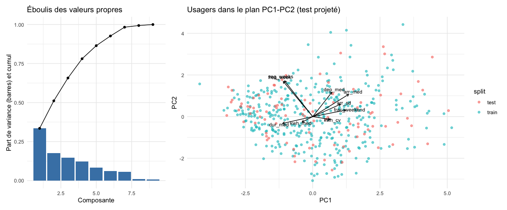
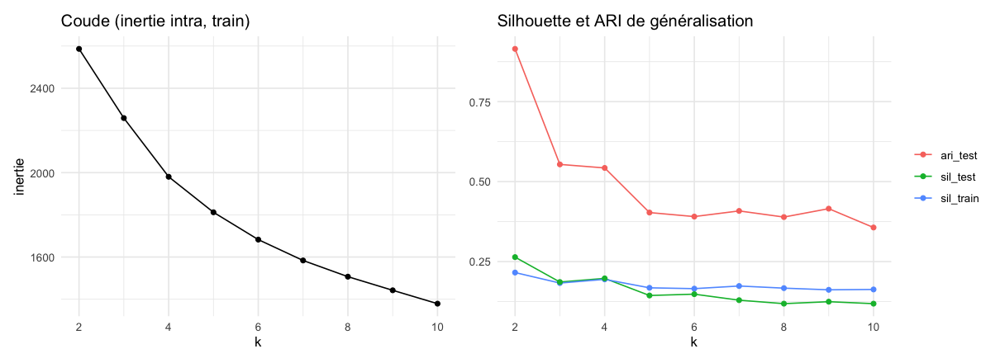
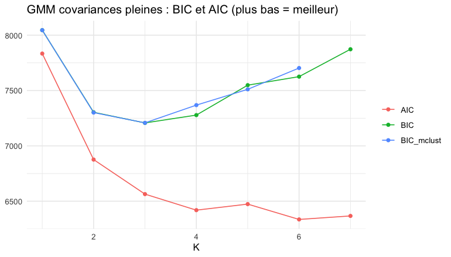
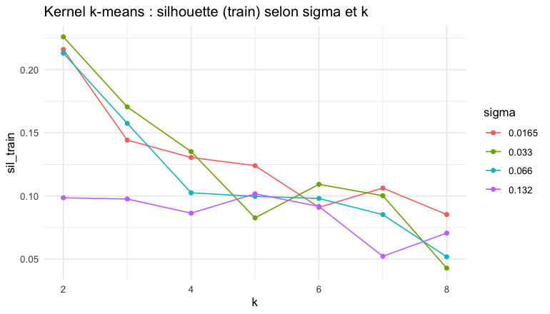
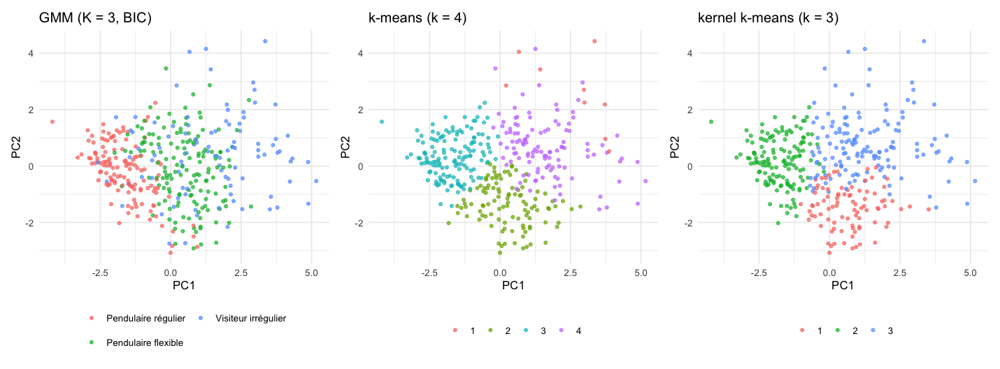
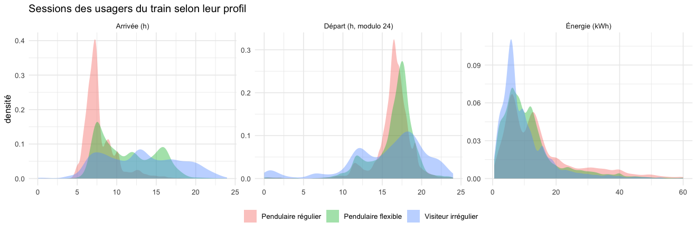
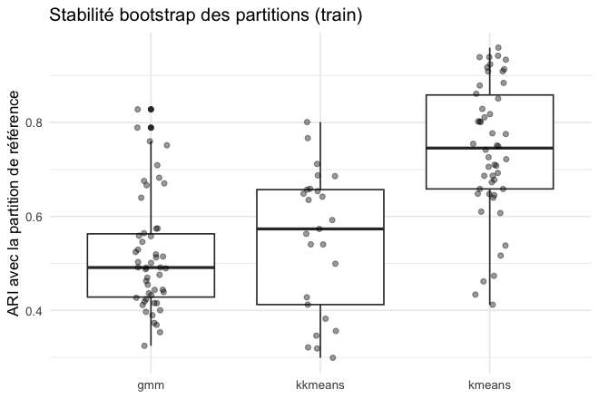
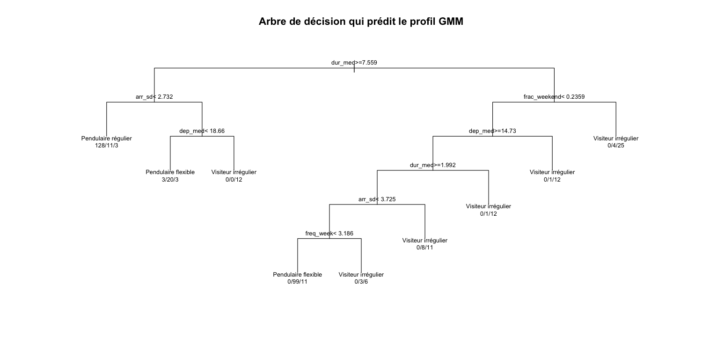
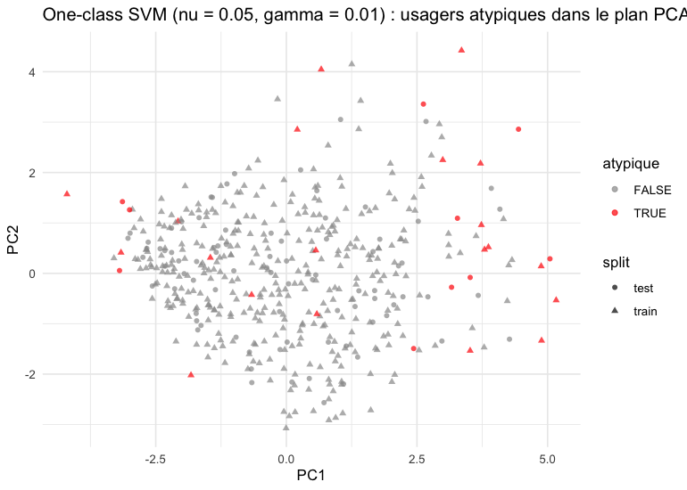
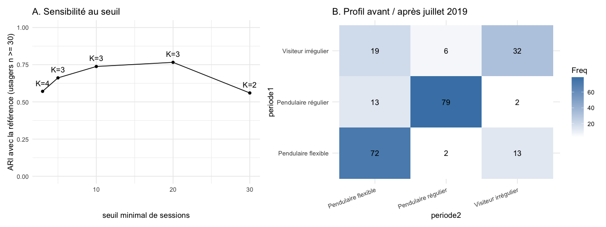

# Projet 2 : profils d'usagers de bornes de recharge (ACN-Data)

SY19, UTC. Apprentissage non supervisé en R. L'objectif est de trouver, sans étiquettes, des profils d'usagers
qui serviront de types d'agents au simulateur multi-agents de l'UV IA04.

Tous les chiffres ci-dessous sortent des scripts de `src/` et des fichiers de `reports/results/`.
Pour tout reproduire, depuis la racine :

```
Rscript src/features.R && Rscript src/pca.R && Rscript src/kmeans.R && Rscript src/gmm.R
Rscript src/kkmeans.R && Rscript src/profiles.R && Rscript src/validation.R && Rscript src/ocsvm.R
Rscript src/investigation.R && Rscript src/generate_agents.R && Rscript src/comparaison.R
Rscript tests/test_features.R && Rscript tests/test_em_gmm.R && Rscript tests/test_generate_agents.R
```

## 1. Données et variables par usager

On part des 46 701 sessions ACN-Data (caltech, jpl, office001, de septembre 2018 à mars 2020). On garde les
sessions qui ont un `userID`, une énergie positive et une durée comprise entre 6 min et 48 h, soit 37 136
sessions et 767 usagers. Les heures sont converties en heure locale (America/Los_Angeles).

Pour chaque usager (`src/features.R`), on calcule 9 variables :

| variable | sens | transformation avant clustering |
|---|---|---|
| `arr_med`, `arr_sd` | heure d'arrivée médiane, écart-type | aucune |
| `dep_med` | heure de départ médiane (arrivée + durée, peut dépasser 24) | aucune |
| `dur_med` | durée médiane (h) | log |
| `kwh_med`, `kwh_cv` | énergie médiane, coefficient de variation | log, log1p |
| `freq_week` | sessions par semaine sur la période d'activité | log |
| `reg_weeks` | part des semaines actives (régularité) | logit |
| `frac_weekend` | part des sessions le week-end | logit |

Les deux proportions sont lissées, (k + 0,5)/(n + 1). Sans ce lissage, 55 % des usagers ont exactement
0 session le week-end : l'EM isolait alors ces usagers dans une composante de variance quasi nulle et la
vraisemblance devenait dégénérée (elle faisait un saut artificiel dès K = 4).

**Seuil minimal de sessions : 10.** L'erreur relative sur un écart-type estimé avec n sessions vaut environ
1/sqrt(2(n-1)) (`reports/results/seuils_sessions.csv`) :

| seuil | usagers | part des sessions identifiées | erreur relative sur `arr_sd` |
|---|---|---|---|
| 3 | 621 | 99,5 % | 50 % |
| 5 | 561 | 98,9 % | 35 % |
| **10** | **466** | **97,2 %** | **24 %** |
| 20 | 365 | 93,4 % | 16 % |
| 30 | 313 | 90,0 % | 13 % |

Avec 10 sessions, on garde 97 % des sessions identifiées et l'écart-type est estimé à environ 24 % près. La
section 9 étudie la sensibilité des résultats à ce choix.

**Protocole sans fuite.** 20 % des usagers sont tirés au hasard et mis de côté (93 usagers de test, 373 de
train, graine 19). La standardisation, la PCA et tous les modèles sont appris sur le train seulement. Les
usagers de test sont projetés ou affectés avec les paramètres du train.

## 2. Standardisation et PCA



Variance expliquée : PC1 33,5 %, PC2 17,6 %, PC3 14,6 % (78 % pour 4 composantes,
`pca_variance.csv`). Le premier plan ne montre pas d'amas bien séparés, seulement un nuage continu, donc les
silhouettes seront faibles quelle que soit la méthode. Lecture des axes (`pca_loadings.csv`) :

- PC1 oppose l'heure d'arrivée tardive et irrégulière, avec du week-end (`arr_med` +0,47, `arr_sd`,
  `frac_weekend`) aux longues durées et à la fréquence (`dur_med` -0,39, `freq_week`, `reg_weeks`). C'est
  l'axe « pendulaire contre occasionnel ».
- PC2 porte surtout la fréquence et la régularité (`freq_week`, `reg_weeks` ≈ +0,58).

Les usagers de test, projetés, recouvrent le même nuage que ceux du train.

## 3. Baseline k-means

**Pourquoi.** C'est la méthode de partition la plus simple. Elle sert de référence aux deux autres.

`src/kmeans.R` : k de 2 à 10, 50 initialisations. Pour chaque k, on calcule l'inertie, la silhouette sur le
train, la silhouette sur le test (chaque usager de test est affecté au centre le plus proche) et l'ARI entre
cette affectation et un k-means refait sur le test seul.



| k | silhouette train | silhouette test | ARI généralisation |
|---|---|---|---|
| 2 | 0,216 | 0,264 | 0,915 |
| 3 | 0,183 | 0,186 | 0,554 |
| **4** | **0,195** | **0,198** | **0,543** |
| 5 | 0,168 | 0,144 | 0,403 |

Le coude n'est pas net. k = 2 a la meilleure silhouette, mais il ne fait qu'opposer les arrivées du matin à
celles de l'après-midi, ce qui est trop grossier pour définir des types d'agents. Parmi k ≥ 3, k = 4 a la
meilleure silhouette. Les quatre groupes (tailles 9, 108, 143, 113) se lisent ainsi : pendulaires réguliers
(arrivée 7 h 30, 2,4 sessions par semaine), pendulaires occasionnels (8 h 30, 0,6 par semaine), usagers de
l'après-midi (14 h, 3 h de charge) et un petit groupe nocturne (arrivée vers 19 h 30, départ le lendemain).

## 4. GMM estimé par EM codé à la main

**Pourquoi.** Un mélange gaussien donne des probabilités d'appartenance et une densité, ce qui permet de
choisir K par vraisemblance pénalisée et de générer des données. C'est exactement ce dont le générateur
d'agents a besoin.

`src/em_gmm.R` implémente l'EM en R de base, avec des matrices et sans aucun paquet :

- E-step en log, avec log-densité gaussienne calculée par Cholesky (`backsolve`) et log-sum-exp ;
- M-step avec covariances pleines, plus 1e-6·I ajouté pour la stabilité numérique ;
- 50 initialisations par partitions k-means aléatoires, on garde la meilleure vraisemblance ;
- un essai est rejeté si une composante descend sous p + 1 = 10 usagers ;
- BIC = -2 logL + q log n, AIC = -2 logL + 2q, avec q = (K-1) + Kp + Kp(p+1)/2.

`tests/test_em_gmm.R` vérifie le résultat sur un mélange simulé. On retrouve les poids et les moyennes, la
log-densité est égale à la formule directe, et la log-vraisemblance et la partition sont égales à celles de
mclust (ARI = 1).



| K | paramètres | logL | BIC | AIC | logL test par usager | BIC mclust (VVV) |
|---|---|---|---|---|---|---|
| 1 | 54 | -3862,9 | 8045,5 | 7833,7 | -11,06 | 8045,5 |
| 2 | 109 | -3329,1 | 7303,6 | 6876,2 | -9,33 | 7301,0 |
| **3** | 164 | -3118,1 | **7207,3** | 6564,2 | **-9,15** | 7207,9 |
| 4 | 219 | -2990,6 | 7278,1 | 6419,2 | -9,61 | 7368,2 |
| 6 | 329 | -2838,7 | 7625,6 | **6335,4** | -9,96 | 7703,4 |

- **Le BIC choisit K = 3.** La log-vraisemblance des usagers de test, jamais vus, est aussi maximale à
  K = 3. Ce critère indépendant confirme le BIC.
- L'AIC, qui pénalise moins, choisit K = 6. Avec 55 paramètres par composante pour 373 usagers, ce choix
  surajuste : la vraisemblance de test baisse dès K = 4.
- Comparaison à mclust (modèle VVV, K = 3) : log-vraisemblance -3118,09 pour l'EM maison contre -3118,38
  pour mclust, ARI entre les partitions 0,907. Les BIC sont égaux à moins de 3 points pour K ≤ 3. À
  K = 4 et K = 6, l'EM maison trouve un meilleur optimum, grâce à ses 50 initialisations contre une seule
  initialisation hiérarchique pour mclust. À K = 5, c'est mclust qui fait mieux.
- Si l'on laisse mclust choisir aussi la forme des covariances (14 modèles), il retient VVE avec G = 4.

## 5. Kernel k-means

**Pourquoi.** Le k-means suppose des groupes convexes et sphériques. Un noyau gaussien permet des frontières
non linéaires.

`src/kkmeans.R` utilise `kernlab::kkmeans` avec un noyau RBF. La grille croise sigma ∈ {0,25 ; 0,5 ; 1 ; 2} ×
la médiane de `sigest`, et k de 2 à 8, avec 10 départs par point (on garde la plus petite inertie dans
l'espace du noyau). Un usager de test est affecté au cluster dont le barycentre est le plus proche dans
l'espace de redescription : 1 - 2·moy K(x, x_i) + moy K(x_i, x_j).



Avec la même règle que pour le k-means (meilleure silhouette parmi k ≥ 3), on retient **sigma = 0,033 et
k = 3** (silhouette 0,170 sur le train, 0,177 sur le test). Les tailles sont 89, 142 et 142. Les trois
groupes se lisent très bien : pendulaires réguliers (arrivée 7 h 20, 2,4 sessions par semaine), pendulaires
occasionnels du matin (0,5 par semaine) et usagers de l'après-midi (arrivée 13 h 45). Les grands sigma
(noyau très local) dégradent nettement la silhouette.

## 6. Profils retenus et noms

On nomme les profils à partir du GMM K = 3 (`src/profiles.R`, `profils_gmm.csv`). Les valeurs sont des
médianes par profil, sur le train puis sur le test.

| profil | jeu | usagers | arrivée | σ arrivée | départ | durée | kWh | sessions/sem. | week-end | part caltech |
|---|---|---|---|---|---|---|---|---|---|---|
| Pendulaire régulier | train | 131 (35 %) | 7,3 h | 1,3 | 16,7 h | 9,3 h | 12,9 | 1,95 | 1 % | 26 % |
| Pendulaire flexible | train | 147 (39 %) | 10,5 h | 2,8 | 17,2 h | 5,2 h | 10,6 | 0,99 | 3 % | 33 % |
| Visiteur irrégulier | train | 95 (25 %) | 13,1 h | 3,0 | 18,0 h | 4,3 h | 9,4 | 1,04 | 12 % | 61 % |
| Pendulaire régulier | test | 36 (39 %) | 7,4 h | 1,3 | 17,0 h | 9,4 h | 11,5 | 2,12 | 1 % | 22 % |
| Pendulaire flexible | test | 30 (32 %) | 11,9 h | 2,7 | 17,1 h | 4,7 h | 9,9 | 1,21 | 4 % | 33 % |
| Visiteur irrégulier | test | 27 (29 %) | 13,8 h | 3,3 | 17,7 h | 3,3 h | 10,0 | 0,78 | 20 % | 70 % |




- **Pendulaire régulier.** Arrive vers 7 h avec une très faible dispersion et repart vers 16 h 45 (pic
  étroit). Il reste branché 9 h et vient environ deux fois par semaine, presque jamais le week-end.
- **Pendulaire flexible.** Arrivées bimodales, vers 8 h ou vers 15 h-16 h, départ vers 17 h. Il reste 5 h et
  vient environ une fois par semaine.
- **Visiteur irrégulier.** Arrivées étalées de 6 h à minuit et départs étalés, y compris le lendemain. Il
  vient plus souvent le week-end, plus souvent sur le campus public de Caltech (61 %), et charge moins
  d'énergie.

Les médianes du test reproduisent celles du train, à l'exception de la durée des visiteurs (3,3 h contre
4,3 h). Les profils se transfèrent donc à des usagers jamais vus.

Les trois méthodes ne découpent pas le nuage de la même façon. Le GMM sépare surtout selon la **dispersion**
(covariances différentes par composante). Le k-means et le kernel k-means séparent selon la **position**
(heure d'arrivée, fréquence). Le pendulaire régulier se retrouve dans les trois méthodes. La frontière
« flexible / visiteur » dépend de la méthode.

## 7. Validation : stabilité et explication

**Stabilité par bootstrap** (`src/validation.R`). Chaque modèle est réappris sur un rééchantillon bootstrap
des usagers du train, puis appliqué à tout le train. On mesure l'ARI avec la partition de référence (50
rééchantillons, 25 pour le kernel k-means, qui est plus coûteux).

| méthode | ARI moyen | écart-type |
|---|---|---|
| k-means (k = 4) | **0,742** | 0,143 |
| kernel k-means (k = 3) | 0,549 | 0,151 |
| GMM (K = 3) | 0,516 | 0,120 |



**Explication des profils GMM.** Une LDA et un arbre CART (élagué par validation croisée 10 plis, 9 feuilles)
prédisent le profil à partir des 9 variables brutes.

| modèle | exactitude train | exactitude test |
|---|---|---|
| LDA | 0,794 | 0,774 |
| arbre | 0,871 | **0,828** |



L'arbre se lit en une règle. Si `dur_med` ≥ 7,6 h et `arr_sd` < 2,7 h, l'usager est un pendulaire régulier
(142 usagers, dont 90 % bien classés). Une durée courte avec 24 % ou plus de week-end, ou bien une durée longue
avec des arrivées dispersées et un départ médian après 18 h 40, désigne un visiteur irrégulier. Les variables les plus importantes sont `dur_med`, `arr_sd`,
`arr_med` et `frac_weekend`. Dans la LDA, le premier axe porte 88 % de la séparation (rapport des valeurs
singulières).

## 8. One-class SVM : usagers atypiques

**Pourquoi.** On veut repérer les usagers qu'aucun profil ne décrit bien, sans faire d'hypothèse gaussienne.

`src/ocsvm.R` utilise `e1071::svm` (type one-classification, noyau radial) avec nu = 0,05, soit 5 %
d'atypiques visés. Gamma est choisi par validation croisée 5 plis sur le train : on prend la valeur pour
laquelle le taux d'atypiques sur les plis mis de côté est le plus proche de nu. On retient **gamma = 0,01**
(taux en CV 5,9 %). Le gamma par défaut de e1071 (1/p = 0,11) surapprend la frontière : 15 % d'atypiques en
CV et sur le test (`ocsvm_grille.csv`).

Résultats : 5,4 % d'atypiques sur le train et 10,8 % sur le test (10 usagers sur 93, avec une erreur-type
binomiale d'environ 2,3 points). Les atypiques sont surtout des visiteurs irréguliers (18,9 % de ce profil,
contre 4,2 % des pendulaires réguliers et 0 % des flexibles). Ils ont moins de sessions (27,5 contre 54), une
arrivée médiane à 13 h 26, 13 % de week-end et une énergie faible (7,3 kWh). 16 des 30 atypiques font aussi
partie des 5 % d'usagers les moins vraisemblables pour le GMM. Les deux détecteurs se recoupent donc
seulement en partie.



## 9. Investigation originale : les profils sont-ils robustes ?

On pose deux questions (`src/investigation.R`).

**A. Le seuil minimal de sessions change-t-il les profils ?** Pour un seuil m ∈ {3, 5, 10, 20, 30}, on
recalcule la standardisation et le GMM (K choisi par BIC entre 1 et 5) sur tous les usagers qui ont au moins
m sessions. On compare ensuite la partition obtenue à la référence (le GMM de la section 4) sur les mêmes 313
usagers qui ont au moins 30 sessions. Leurs variables sont identiques quel que soit m : seule la population
d'apprentissage change.

| seuil | usagers | K (BIC) | ARI avec la référence |
|---|---|---|---|
| 3 | 621 | 4 | 0,571 |
| 5 | 561 | 3 | 0,661 |
| 10 | 466 | 3 | 0,738 |
| 20 | 365 | 3 | 0,766 |
| 30 | 313 | 2 | 0,560 |

K = 3 est stable entre 5 et 20 sessions. En dessous, les usagers à 3 ou 4 sessions, dont les écarts-types sont
très bruités, créent une 4e composante. Au-dessus, il ne reste plus assez d'usagers pour 164 paramètres, et
le BIC retombe à K = 2. Le seuil de 10 se trouve dans la zone stable. L'ARI de 0,74 à m = 10, et non 1,
mesure l'effet de l'apprentissage sur 466 usagers au lieu des 373 du train.

**B. Un usager garde-t-il son profil d'une période à l'autre ?** On coupe au 1er juillet 2019. Les variables
sont recalculées séparément sur chaque période pour les 238 usagers qui ont au moins 10 sessions dans les
deux. Les deux versions sont affectées avec le même GMM de référence.

- Profil identique pour **76,9 %** des usagers, contre 35,1 % attendus au hasard : kappa de Cohen 0,64,
  ARI 0,46.
- Le pendulaire régulier est le plus stable (79 usagers sur 94 restent réguliers). Le visiteur irrégulier
  l'est le moins : 19 usagers sur 57 deviennent flexibles.
- Corrélation des variables d'un même usager entre les deux périodes : énergie 0,91, arrivée 0,84,
  durée 0,82, mais régularité hebdomadaire seulement 0,45. Les habitudes horaires sont des traits stables.
  La régularité est la variable la plus fragile.



## 10. Générateur d'agents pour IA04

`src/generate_agents.R` apprend, pour chaque profil, un GMM au niveau des **sessions** des usagers du train.
L'espace est (heure d'arrivée, log durée, log énergie), avec l'EM maison. Le log garantit des durées et des
énergies positives. Le BIC décroît encore à K = 8 avec ces 5 000 à 13 000 sessions par profil. On retient
donc le premier K dont le passage à K + 1 améliore le BIC de moins de 1 % : **K = 4, 3 et 4**
(`agents_choix_K.csv`).

Les paramètres sont exportés dans **`reports/results/agents_gmm.json`**, un JSON simple que Go lit avec
`encoding/json` :

```json
{ "timezone": "America/Los_Angeles",
  "variables": ["arrival_hour", "log_duration_h", "log_energy_kwh"],
  "transform": "departure_h = arrival_h + exp(log_duration_h) ; energy_kwh = exp(log_energy_kwh) ; ...",
  "profiles": [ { "name": "Pendulaire régulier", "weight": 0.3512, "session_share": 0.4507,
                  "sessions_per_week_median": ...,
                  "components": [ { "weight": ..., "mean": [3 réels], "cov": [[3x3]] } ] } ] }
```

Le JSON donne deux poids par profil. `weight` est la part des usagers : c'est la proportion de chaque type
d'agent dans la population. `session_share` est la part des sessions : c'est la proportion à utiliser pour
tirer des véhicules. `generate_agents(n)` tire un profil, puis une composante, puis un vecteur gaussien. Les
tirages hors bornes (arrivée hors [0, 24), durée hors [0,1 h ; 48 h]) sont rejetés.

**Test de Kolmogorov-Smirnov** (`tests/test_generate_agents.R`, `ks_generateur.csv`). On génère 20 000
véhicules. Avec des milliers de sessions, la p-value rejette au moindre écart : le test porte donc sur la
statistique D.

| comparaison | arrivée | départ | énergie |
|---|---|---|---|
| générées vs sessions réelles du train | 0,034 | 0,031 | 0,031 |
| générées vs sessions réelles du **test** | 0,115 | 0,078 | 0,075 |
| référence : réelles du train vs réelles du test | 0,097 | 0,074 | 0,082 |

Sur le train, l'écart est inférieur à 0,06 pour chaque profil et chaque variable. Le générateur reproduit
donc les distributions marginales apprises. Sur les usagers de test, l'écart est du même ordre que celui qui
sépare déjà les sessions réelles du train et du test (D de 0,07 à 0,10) : il vient de la variabilité entre
usagers (93 usagers de test seulement) et non du générateur. Le profil visiteur irrégulier est le moins bien
reproduit (D = 0,27 sur l'arrivée), mais le D réel/réel vaut déjà 0,28 pour ce profil.

## Tableau comparatif

`src/comparaison.R`, `comparaison.csv` :

| méthode | K | choix de K | silhouette train | silhouette test | ARI bootstrap | ARI avec le GMM |
|---|---|---|---|---|---|---|
| k-means (baseline) | 4 | coude + silhouette | **0,195** | **0,198** | **0,742** | 0,216 |
| GMM, EM maison | 3 | BIC, confirmé par la logL de test | 0,094 | 0,080 | 0,516 | 1 |
| kernel k-means (RBF) | 3 | silhouette sur la grille sigma × k | 0,170 | 0,177 | 0,549 | 0,272 |

**Lecture.**

- La silhouette euclidienne mesure exactement ce que le k-means optimise : elle le favorise par construction.
- Le GMM sépare les usagers par leur dispersion (covariances), ce que la silhouette ne voit pas. Sa
  silhouette faible ne veut donc pas dire que la partition est mauvaise.
- Sur la stabilité, la baseline k-means gagne (ARI bootstrap 0,74).
- **Le modèle retenu pour IA04 est le GMM K = 3.** C'est le seul des trois qui soit génératif. K = 3 est
  choisi par deux critères indépendants (BIC et vraisemblance de test). Ses profils se prédisent à 83 % sur
  le test avec un arbre de 9 feuilles. Ils sont stables pour 77 % des usagers entre deux périodes (kappa
  0,64). Enfin, il alimente un générateur validé par KS (D ≤ 0,06 sur le train, et sur le test un écart égal
  à celui qui sépare déjà les vrais usagers).
- La baseline reste meilleure en stabilité et en silhouette. Si l'on veut seulement une typologie
  descriptive, le k-means k = 4 est un choix raisonnable : il isole en plus un petit groupe nocturne de 9
  usagers.

## Limites

- **Structure faible.** Les silhouettes sont toutes inférieures à 0,27 : les usagers forment un continuum
  plutôt que des groupes nets. Les profils sont une discrétisation utile, pas des classes naturelles.
- **Peu de données pour un GMM plein en dimension 9.** 164 paramètres pour 373 usagers, d'où une stabilité
  bootstrap moyenne (0,52) et un K qui dépend du seuil (section 9A). Des covariances contraintes (diagonales,
  partagées) seraient plus stables.
- **Variables marginales seulement.** Le générateur reproduit les lois jointes (arrivée, durée, énergie) d'une
  session, mais pas la corrélation entre les sessions d'un même usager (jour de la semaine, habitudes). La
  fréquence est exportée comme médiane par profil, sans loi.
- **Énergie livrée, pas énergie demandée.** `kWhDelivered` est bornée par la puissance de la borne et par le
  pilotage du site. Ce qu'on modélise est donc en partie le résultat de l'ordonnancement ACN, pas la demande
  brute. La queue de la log-normale peut aussi produire des énergies irréalistes (plus de 100 kWh, rarement).
  Le simulateur doit les plafonner par puissance × durée.
- **Sites mélangés.** Caltech (campus public) et JPL (site fermé) ont des populations différentes, et le
  profil visiteur est à 61 % caltech. Un GMM par site serait plus fidèle, mais il aurait moins de données.
- **Période pré-COVID** (jusqu'en mars 2020) : les profils décrivent des habitudes de travail sur site.

## Lien avec le projet IA04

Le simulateur IA04 (Go) répartit la puissance limitée d'un site entre des véhicules, avec les stratégies
EDF (échéance la plus proche), LLF (laxité la plus faible) et sLLF. Ces stratégies dépendent toutes de
l'heure de départ et de l'énergie à fournir de chaque véhicule. Ce projet leur apporte :

1. **Des types d'agents fondés sur les données.** Trois profils avec leur poids dans la population (35 %
   pendulaires réguliers, 39 % flexibles, 25 % visiteurs irréguliers), à la place d'arrivées uniformes.
2. **Un générateur réaliste.** Le simulateur Go lit `agents_gmm.json`. Pour chaque véhicule, il tire un profil
   selon `session_share`, puis une composante selon `weight`, puis z = mean + Lᵀε, avec L le facteur de
   Cholesky de `cov` et ε normal. Il applique ensuite `transform`. Le code Go ne fait qu'une factorisation de
   Cholesky 3×3.
3. **Des scénarios de stress.** On peut faire varier la part de chaque profil. Les pendulaires réguliers
   arrivent tous vers 7 h et restent 9 h : ils créent un pic de demande le matin, mais avec beaucoup de laxité,
   ce qui est favorable à LLF et sLLF. Les visiteurs irréguliers restent peu de temps : leur laxité est faible
   et ce sont eux qui mettent EDF en difficulté. Les usagers atypiques du one-class SVM peuvent servir de cas
   limites.
